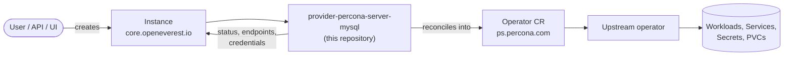

# provider-percona-server-mysql

<!-- TODO(provider): replace the heading with the product name (e.g. "Percona Server for MongoDB
Provider", "KubeAI Provider"). -->

> [!WARNING]
> **Pre-alpha.** OpenEverest v2 and this provider are under active development. CRD schemas,
> chart values and defaults change frequently, including in breaking ways, and there is no
> supported upgrade path between versions yet. Not for production use.

<!-- TODO(sdk): remove the pre-alpha banner and the status badge at v2 GA. -->

[](https://github.com/openeverest/openeverest)
[](https://github.com/openeverest/provider-percona-server-mysql/actions/workflows/ci.yaml)
[](https://github.com/openeverest/provider-percona-server-mysql/releases)
[](https://pkg.go.dev/github.com/openeverest/provider-percona-server-mysql)
[](LICENSE)

<!-- TODO(provider): one sentence — what this runs, and on top of which operator. -->
Run **`<technology>`** on Kubernetes through [OpenEverest](https://github.com/openeverest/openeverest),
backed by the [`<operator>`](https://example.com/operator).

## What this is

OpenEverest providers translate a single, technology-agnostic `Instance` custom resource into
the native custom resources of an upstream Kubernetes operator — for databases, but equally
for caches, message queues, object storage, or model-serving runtimes. This repository is the
provider for `<technology>`: it owns the technology-specific knowledge — topologies, versions,
parameters, backup wiring — so that users, the API server, and the UI stay technology-agnostic.

> [!IMPORTANT]
> **This provider is not standalone.** It requires an OpenEverest installation (core CRDs and
> controller) in the cluster. Installing this chart on its own does nothing.
> See [Install OpenEverest](https://openeverest.io/documentation/current/quick-install.html).



The provider watches `Instance` resources whose `spec.providerRef.name` is
`percona-server-mysql`, and reports workload health back onto `Instance.status`. It never
manages pods directly — all lifecycle work is delegated to the operator.

## Compatibility

<!-- TODO(provider): keep this table accurate for every release. -->

| provider-percona-server-mysql | OpenEverest | Operator | Kubernetes |
|---|---|---|---|
| `0.3.x` | `2.0.0-alpha.1` | `1.2.x` | `1.32` – `1.34` |
| `0.2.x` | `>= 2.0.0-dev.4` | `x.y.z` | `1.30` – `1.34` |
| `0.1.x` | `>= 2.0.0-dev.4` | `x.y.z` | `1.30` – `1.34` |

## Capabilities

<!-- TODO(provider): the rows below are the standard set across all OpenEverest providers.
     Keep the wording of the rows you use identical so providers stay comparable, and delete
     the rows that make no sense for this technology rather than marking them unsupported. -->

What you can do to a running instance through the `Instance` API. Upgrading the
provider itself is covered under [Installation](#installation).

| Capability | Status | Notes |
|---|---|---|
| Provisioning | ✅ | `async` and `groupreplication` topologies. Any layout is accepted, down to a single node with a single proxy for development: the provider does not apply the operator's production sizing rules (odd group-replication sizes, two or more Routers, three or more Orchestrator nodes). On `async`, a failover recovers the transactions the failed primary had not shipped only when backups are enabled; without them, Orchestrator promotes a replica and those transactions are lost |
| Horizontal scaling | ✅ | Engine, proxy, and orchestrator replica counts |
| Vertical scaling (CPU / memory) | ✅ | Requests and limits on the engine and proxy |
| Version upgrades | ❌ | Version is selected at create time |
| Custom configuration | ✅ | `spec.components.engine.parameters.configuration` — see [Custom MySQL configuration](#custom-mysql-configuration) |
| Exposure | ✅ | `spec.components.<name>.service.serviceType`: `ClusterIP` (default), `LoadBalancer` or `NodePort`, for `engine` and `proxy` independently — both are exposed in the UI. `proxy.service` controls how clients reach HAProxy/Router and is how most clients should connect; `engine.service` exposes the MySQL primary and per-pod Services directly, bypassing the proxy, for clients that need a direct connection. `service.annotations` and, for `LoadBalancer`, `service.loadBalancerService.sourceRanges` are also supported on both, but only via the `Instance` spec directly — the UI doesn't expose them yet ([openeverest#1959](https://github.com/openeverest/openeverest/issues/1959), [openeverest#2398](https://github.com/openeverest/openeverest/issues/2398)) |
| Monitoring | ✅ | PMM, via the optional `monitoring` component |
| TLS | ✅ | Always on (the operator's default); `preferTLS` or `requireTLS`; bring your own certificate secret or CA (cert-manager issuer), extra DNS names — see [TLS](#tls) |

Stateful workloads additionally report:

| Capability | Status | Notes |
|---|---|---|
| Persistent storage | ✅ | PVC size and storage class on the engine |
| Storage expansion | ✅ | Increase `engine.storage.size`; the StorageClass must allow expansion |
| Backups (on demand) | ✅ | Full and incremental backups to `s3` BackupStorages (Amazon S3 and S3-compatible stores); `tls.insecureSkipVerify` is honoured, a custom CA (`tls.ca`) is not |
| Backups (scheduled) | ✅ | Cron schedules with retention, S3 only |
| Point-in-time recovery | ❌ | |
| Restore | ✅ | From a backup of the same instance; not point-in-time |

## Installation

<!-- TODO(provider): confirm the published chart coordinates (org/repo) match where you publish. -->

The provider chart is published as an OCI artifact:

```bash
helm install provider-percona-server-mysql \
  oci://ghcr.io/openeverest/charts/provider-percona-server-mysql \
  --version <chart-version> \
  --namespace everest-system
```

The operator is bundled as a chart dependency (`ps-operator`, configured with
`watchAllNamespaces: true`) and is installed automatically.

The chart registers an admission webhook, so an invalid `Instance` is rejected when it is
written, with every error and its field path. Its serving certificate is generated by the
chart and kept across upgrades; set `admission.certManager.enabled=true` to have
cert-manager issue it, or supply one through `admission.certs`. If the provider is down,
writes are admitted and the `Instance` reports the errors in its `Ready` condition. A
missing object the `Instance` names, such as its user Secret, is never a reason to reject
it: `kubectl` prints a warning, and the `Instance` reports it once created.

Upgrade and uninstall:

```bash
helm upgrade provider-percona-server-mysql oci://ghcr.io/openeverest/charts/provider-percona-server-mysql
helm uninstall provider-percona-server-mysql --namespace everest-system
```

Uninstalling the chart does **not** delete running `Instance` resources or their data.

## Usage

Verify that the provider registered itself:

```bash
kubectl get providers.core.openeverest.io percona-server-mysql
```

Create an instance:

```yaml
apiVersion: core.openeverest.io/v1alpha1
kind: Instance
metadata:
  name: my-instance
spec:
  providerRef:
    name: percona-server-mysql
  components:
    engine:
      type: 
      replicas: 3
      resources:
        requests:
          cpu: 500m
          memory: 2G
      storage:
        size: 10Gi
```

Component names are defined by this provider — see [definition/provider.yaml](definition/provider.yaml).
`spec.version` and `spec.topology` are optional; the provider defaults apply.
More examples live in [examples/](examples/).

Watch it come up and read the connection details:

```bash
kubectl get instance my-instance -w
kubectl get instance my-instance -o jsonpath='{.status.connection}'
```

Credentials, when the technology has any, are in the secret named by
`.status.connection.credentialsSecretRef`.

## Topologies

<!-- TODO(sdk): these blocks are hand-maintained until `provider-sdk generate` fills them
     from definition/. Until then, update them whenever definition/ changes. -->

<!-- BEGIN GENERATED: topologies -->
| Topology | Default | Description |
|---|---|---|
| `` | ✅ | |
<!-- END GENERATED: topologies -->

## Versions

<!-- BEGIN GENERATED: versions -->
| Version bundle | Default |  |
|---|---|---|
| | | |
<!-- END GENERATED: versions -->

Source of truth: [definition/versions.yaml](definition/versions.yaml).

<!-- TODO(provider): document the supported upgrade paths (minor only? operator first?). -->

## Configuration

- **Chart values:** [charts/provider-percona-server-mysql/values.yaml](charts/provider-percona-server-mysql/values.yaml)
- **Instance parameters:** per-component and per-topology `parameters` schemas, defined under
  [definition/](definition/) and published on the `Provider` resource
  (`kubectl get provider percona-server-mysql -o yaml`). The provider rejects an Instance
  that does not match them, and the UI checks the form against them as you type.

This provider currently exposes two technology-specific parameters beyond the shared
component fields (replicas, resources, storage): `engine.parameters.configuration`,
covered in [Custom MySQL configuration](#custom-mysql-configuration), and instance-wide
`spec.parameters.tls`, covered in [TLS](#tls).

## Custom MySQL configuration

`spec.components.engine.parameters.configuration` is a YAML document of flat
MySQL parameter key/value pairs. The provider writes them onto the operator
cluster as `spec.mysql.configuration`, which overrides the operator defaults.

```yaml
spec:
  components:
    engine:
      type: mysql
      parameters:
        configuration: |
          max_connections: "500"
          innodb_buffer_pool_size: 1G
          innodb_flush_log_at_trx_commit: 2
```

See [examples/instance-custom-config.yaml](examples/instance-custom-config.yaml).

## TLS

The PS operator always encrypts connections between members and clients with TLS; it
cannot be disabled. Configure it with the instance-wide `tls` parameter:

```yaml
spec:
  parameters:
    tls:
      mode: requireTLS                 # preferTLS (default) | requireTLS
      # Pick one certificate source, or neither to have a certificate issued:
      certificateSecretName: my-certs  # tls.crt, tls.key and ca.crt
      issuer:                          # cert-manager
        name: company-ca
        kind: Issuer                   # Issuer (default) | ClusterIssuer
        group: cert-manager.io         # the only group supported
      additionalNames:                 # DNS names clients use, besides the in-cluster ones
        - mydb.company.com
```

- **`preferTLS`** lets clients choose whether to use TLS; **`requireTLS`** additionally sets
  `require_secure_transport=ON` in the engine's configuration, rejecting clients that don't use
  TLS (a `require_secure_transport` you set in the
  [custom configuration](#custom-mysql-configuration) wins). The provider's own metrics
  exporters then connect with TLS too. Switching the mode on a running instance restarts its
  pods.
- **Certificate**, in order of precedence:
  1. your secret, `certificateSecretName`, with `tls.crt`, `tls.key` and `ca.crt`. Its subject
     alternative names must cover the instance's service and pod names (see the operator's
     [TLS documentation](https://docs.percona.com/percona-operator-for-mysql/ps/tls.html)).
     The operator never replaces a secret it did not create;
  2. a cert-manager `issuer` — requires cert-manager installed in the cluster. External
     issuers (another `group`, such as AWS Private CA) are rejected until the operator supports
     them ([K8SPS-989](https://perconadev.atlassian.net/browse/K8SPS-989)). `ClusterIssuer`
     needs PS operator 1.3.0 or later, which the chart bundles
     ([K8SPS-649](https://perconadev.atlassian.net/browse/K8SPS-649));
  3. otherwise the operator issues it: through cert-manager with a CA of its own when
     cert-manager is installed, or else from a self-signed CA it creates for the instance.

  The certificate source can only be set when the instance is created: a new CA later would
  not be trusted by members or clients already holding the old one.
- **`additionalNames`** adds DNS names (no IP addresses; wildcards are fine) to the issued or
  generated certificate, for clients that reach the instance under another name, such as an
  exposed proxy behind `mydb.company.com`. It can't be combined with `certificateSecretName`,
  whose certificate carries its own names. Changing it on a running instance reissues the
  certificate from the same issuer and restarts the pods, so it holds for a
  `tls-names-<hash>` maintenance approval (a rolling restart; see
  `status.pendingMaintenance`). That needs a certificate issued by cert-manager: on an instance
  whose certificate comes from the CA the operator generated without it, the names can only be
  set at creation.
- **Clients** need only the CA to verify the instance: the connection secret
  (`<instance>-conn`) carries it as `ca.crt` once it has been issued.

### Bring your own CA

To have clients connect to `mydb.company.com` with full verification against your company CA,
give cert-manager the CA and let it sign the instance's certificate:

```yaml
apiVersion: v1
kind: Secret
metadata:
  name: company-ca
  namespace: default               # the instance namespace
type: kubernetes.io/tls
data:
  tls.crt: <base64 CA certificate>
  tls.key: <base64 CA key>
---
apiVersion: cert-manager.io/v1
kind: Issuer
metadata:
  name: company-ca
  namespace: default
spec:
  ca:
    secretName: company-ca
---
apiVersion: core.openeverest.io/v1alpha1
kind: Instance
metadata:
  name: mydb
  namespace: default
spec:
  # ...
  parameters:
    tls:
      mode: requireTLS
      issuer:
        name: company-ca
      additionalNames:
        - mydb.company.com
```

Point `mydb.company.com` at the address clients reach the instance on (for example the proxy's
exposed load balancer). Clients then verify the server against `ca.crt` from `mydb-conn`, for
instance `mysql --ssl-mode=VERIFY_IDENTITY --ssl-ca=ca.crt -h mydb.company.com …`. See
[examples/instance-tls.yaml](examples/instance-tls.yaml).

## Development

Requires Go (see [go.mod](go.mod)), Docker, Helm, kubectl, and a Kubernetes cluster you can
reach. [dev/README.md](dev/README.md) covers the environment end to end: the recommended
local k3d setup, running against a cluster you already have, and every `dev/.env` setting.

```bash
make dev-up             # local cluster + Tilt dev environment (see dev/README.md)
make generate           # RBAC, provider spec, Helm chart sync
make run                # run the provider locally against the cluster
make test-unit
make test-integration   # chainsaw suites under test/integration/
make dev-down
```

`make help` lists every target. `make verify` fails when generated files are stale — run
`make generate` and commit the result.

The provider contract (`Validate` / `Sync` / `Status` / `Cleanup`), RBAC markers, watches,
code generation, and the backup/restore interfaces are documented once for all providers in
[PROVIDER_DEVELOPMENT.md](https://github.com/openeverest/provider-sdk/blob/main/PROVIDER_DEVELOPMENT.md).

### Layout

| Path | Purpose |
|---|---|
| `cmd/provider/` | Entry point |
| `internal/provider/` | `ProviderInterface` implementation, backup interfaces, RBAC markers |
| `internal/common/` | Component name constants |
| `definition/` | Provider identity, component types, versions, topologies, backup classes |
| `charts/provider-percona-server-mysql/` | Helm chart (`generated/` is produced by `make generate`) |
| `config/rbac/role.yaml` | Generated `ClusterRole` — do not edit |
| `test/integration/` | Chainsaw suites (see its `README.md`) |
| `test/vars.sh` | Pinned operator and workload versions used by tests |
| `examples/` | Example `Instance` resources |
| `dev/` | Tilt dev environment, `.env` configuration, k3d cluster config |
| `.github/workflows/` | CI: lint, build, unit and integration tests, release |

### Testing

- **Unit tests** — `make test-unit`.
- **Integration tests** — chainsaw suites under `test/integration/` (`core/cluster`,
  `core/admission`, `core/tls`, `backup/datasource`, `monitoring/pmm`). The operator is scaled
  to 0 and status is simulated. See [test/integration/README.md](test/integration/README.md).
  Individual suites are also exposed as make targets (`make test-integration-core`,
  `make test-integration-core-admission`, `make test-integration-backup`,
  `make test-integration-monitoring-pmm`).
- **E2E cluster tests** — `test/e2e-cluster/` runs against a real PS operator
  (`core/tls`, `datasource/backup`, `monitoring/pmm`).
  Not executed on default CI runners; use `make deploy-provider-e2e` then
  `make test-e2e-cluster` locally.
- **CI** — `.github/workflows/ci.yaml` runs lint, build, unit tests, generated-file
  verification, Helm lint, and the integration suites on every pull request.

## Troubleshooting

```bash
kubectl logs -n everest-system deploy/provider-percona-server-mysql -f
```

| Symptom | Where to look |
|---|---|
| `Instance` stuck in `Creating` | `kubectl describe instance <name>` conditions, then the provider logs |
| No `Provider` resource in the cluster | Is the chart installed? Check the provider deployment logs |
| `Instance` ignored entirely | `spec.providerRef.name` must be `percona-server-mysql` |
| Operator resource created but no pods | Inspect the operator's custom resource status — the failure is upstream |

<!-- TODO(provider): add technology-specific gotchas (sysctl limits, storage class or GPU
     requirements, node selectors, …). -->

## Contributing

Issues and pull requests are welcome. See
[PROVIDER_DEVELOPMENT.md](https://github.com/openeverest/provider-sdk/blob/main/PROVIDER_DEVELOPMENT.md)
and the [OpenEverest Code of Conduct](https://github.com/openeverest/openeverest/blob/main/CODE_OF_CONDUCT.md).

## Security

Report vulnerabilities per the
[OpenEverest security policy](https://github.com/openeverest/openeverest/blob/main/SECURITY.md).
Please do not open public issues for security reports.

## License

Apache License 2.0 — see [LICENSE](LICENSE) for details.
